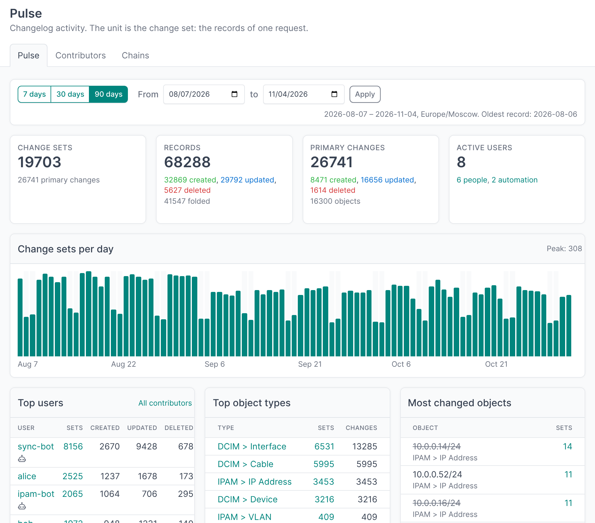
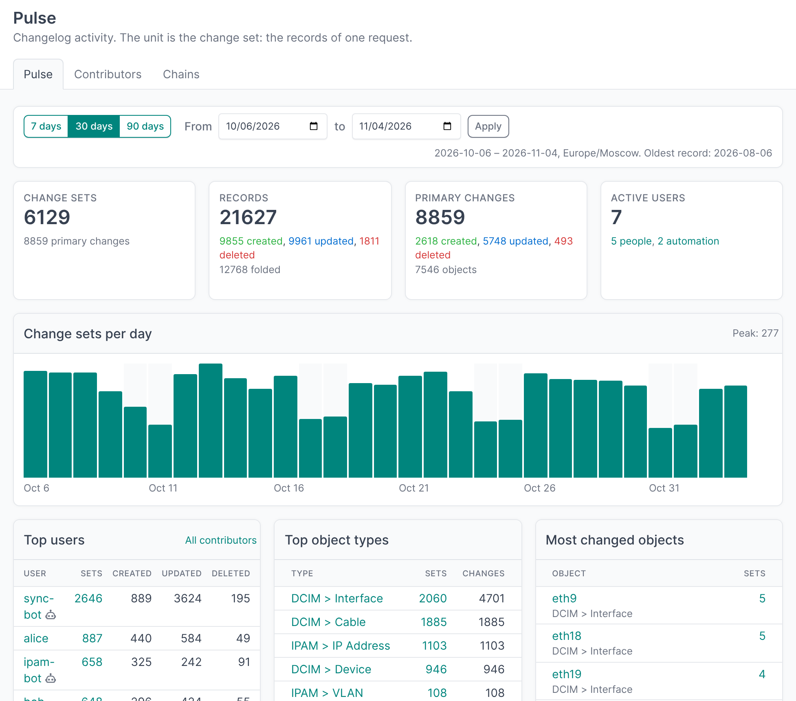
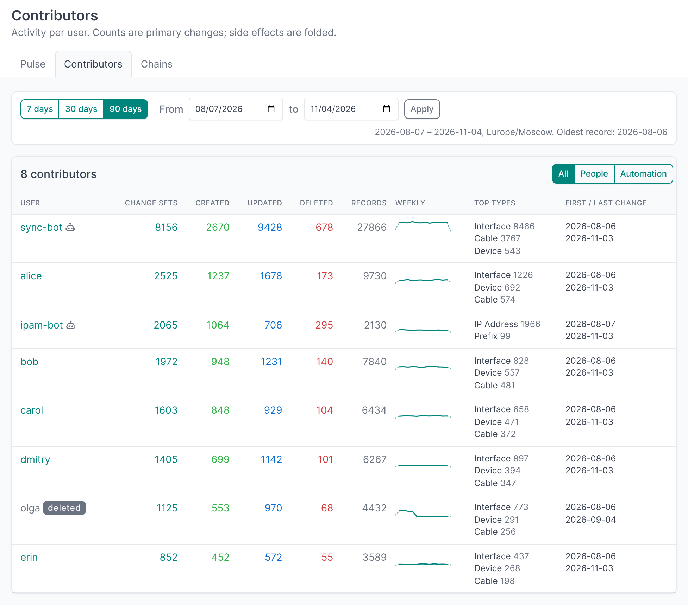
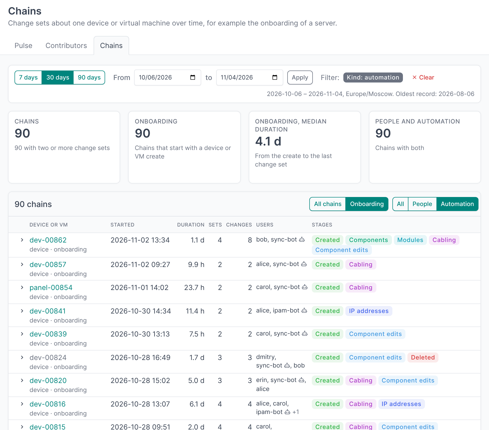
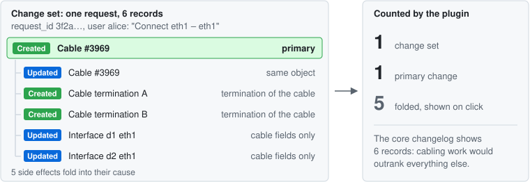

# NetBox Changelog Insights

[](https://github.com/islepnev/netbox-changelog-insights/actions/workflows/test.yml)
[](https://github.com/netbox-community/netbox)
[](pyproject.toml)
[](LICENSE)

**Who changes your NetBox, what and how much.** The core changelog is a flat list of records: it tells what happened to one object, not where the work goes. This plugin groups the changelog into change sets and shows activity by user, object type and time, in the manner of GitHub Insights.



A NetBox plugin. Reads the changelog in place: no models, no migrations, no copy of the data.

## What you can see

- **Pulse.** A period at a glance: change sets, records by action, active people and automation accounts, change sets per day, top users, object types and most changed objects, the latest change sets. Click a change set to see all its records.
- **Contributors.** Per user: change sets, created, updated and deleted objects, a weekly trend, top object types, first and last change. Split people from automation with one user group.
- **Chains.** The change sets about one device or virtual machine over days, for example the onboarding of a server: stages, duration, who took part.
- **Grafana.** The same aggregates over the REST API, and a ready row of panels for the Infinity data source.

Every number links to the core changelog with the same filter. Days and weeks follow the NetBox `TIME_ZONE`.

| Pulse | Contributors | Chains |
|---|---|---|
|  |  |  |

The screenshots use a synthetic changelog (`dev/generate_changelog.py`); no real data is shown.

## How the numbers are counted

The unit is the change set: the records of one request (`request_id`). Side effects fold into their cause, so that a change counts once. Creating one cable writes six records; the plugin counts one change set and one primary change, and shows the other five on click.



Records fold when they are a further record of the same object, components created with their device, cable terminations and cable-only updates of a new cable, or a primary IP update made with its IP address. On a production changelog 45% of the records fold. The rules and their checks are in [docs/design.md](docs/design.md).

## Requirements

- NetBox 4.6 or 4.7 (tested on 4.6.4, 4.6.10, 4.7.4)
- PostgreSQL, as NetBox
- Python 3.12 or later

## Install

```bash
pip install git+https://github.com/islepnev/netbox-changelog-insights
```

In `configuration.py`:

```python
PLUGINS = ['netbox_changelog_insights']
```

Then `manage.py collectstatic`, and restart NetBox. The pages are under Insights in the menu.

## Configuration

All settings are optional: `PLUGINS_CONFIG = {'netbox_changelog_insights': {...}}`.

| Setting | Default | Description |
|---|---|---|
| `automation_group` | `None` | User group of automation accounts. Unset: no split into people and automation |
| `cache_ttl` | `300` | Cache lifetime of the aggregates, seconds; `0` disables the cache |
| `max_period_days` | `None` | Longest period of a page or API call, days; a longer one keeps its last days. Unset: no limit |
| `chain_gap_hours` | `168` | Chains: longest gap between change sets on one device or VM |
| `automation_gap_hours` | `24` | Chains: longest gap that automation alone may bridge |

## Permissions and performance

The pages and the API require `core.view_objectchange`, as the core changelog, and show only the records the user may view. Aggregates are SQL over the indexed time range and are cached per filter. On a synthetic changelog of 65,705 records in 90 days, with the cache off: Pulse 1.2 s, Contributors 0.9 s, Chains 2.4 s.

## API for Grafana

`GET /api/plugins/changelog-insights/activity/` returns a flat JSON array for the Grafana Infinity data source.

| Parameter | Values |
|---|---|
| `group` | `day`, `week` (time series), `user`, `type` (top lists) |
| `from`, `to` | Milliseconds since the epoch: Grafana `${__from}`, `${__to}`. Or `period` (`7`, `30`, `90`, `custom`) with `start`, `end` |
| `user_id`, `user_name`, `type_id`, `action`, `kind` | Filters; `kind`: `person`, `automation` or `all` |
| `limit` | Rows of a top list: default 10, at most 100 |

```bash
curl -H "Authorization: Bearer nbt_<key>.<token>" \
  "https://netbox.example.com/api/plugins/changelog-insights/activity/?group=day&period=7"
```

```json
[{"time": "2026-10-29T00:00:00+03:00", "change_sets": 236, "changes": 287, "created": 91,
  "updated": 179, "deleted": 17, "records": 651}, ...]
```

`changes` counts primary changes, `records` all records. When `max_period_days` cuts the period, the header `X-Period-Cut-From` names the first day asked for.

[docs/grafana-row.json](docs/grafana-row.json) is a row of four panels on this endpoint: totals, change sets per day or week, top users, top object types. Copy its `panels` and `templating.list` into a dashboard, and set the Infinity data source URL to the NetBox base URL with an `Authorization` header that holds the token.

## Limitations

- The core changelog list cannot filter by fold: a link from a count of primary changes opens a list that also holds the folded records.
- No grouping by site or tenant yet.
- Changes merged from `netbox_branching` are not treated in a special way.
- Reach is bounded by `CHANGELOG_RETENTION`; every page shows the oldest available record.

## Development

```bash
docker compose -f dev/docker-compose.yml up -d    # NetBox 4.6.4 with this checkout, http://localhost:8001, admin / admin
python manage.py test netbox_changelog_insights   # in the NetBox directory, with the plugin installed
```

Synthetic data, the audit tools for a real changelog and the timing script: [docs/development.md](docs/development.md). Design notes: [docs/design.md](docs/design.md).

## Contributing

Issues and pull requests are welcome. Run the tests before sending a change; CI runs them on NetBox 4.6 and 4.7. Contributions are accepted under the Apache License 2.0, as the rest of the project.

## License

Apache License 2.0, see [LICENSE](LICENSE). Free to use, modify and redistribute, commercially too. Redistributions and derivative works must keep the copyright and [NOTICE](NOTICE) with the author's name, Ilia Slepnev.
